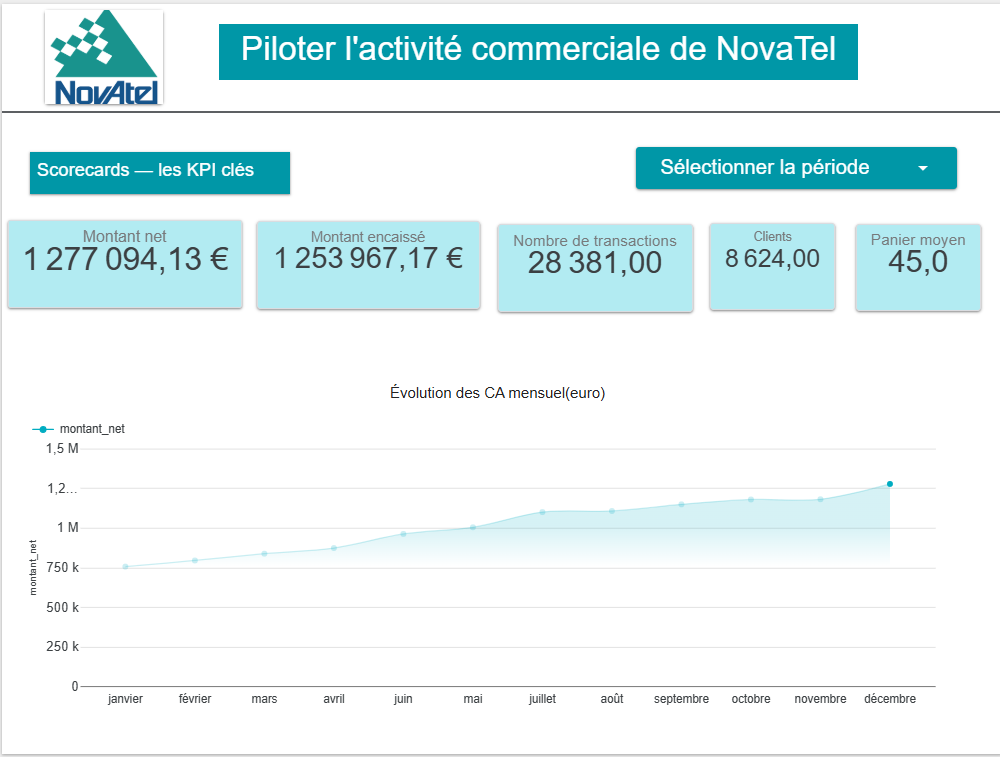
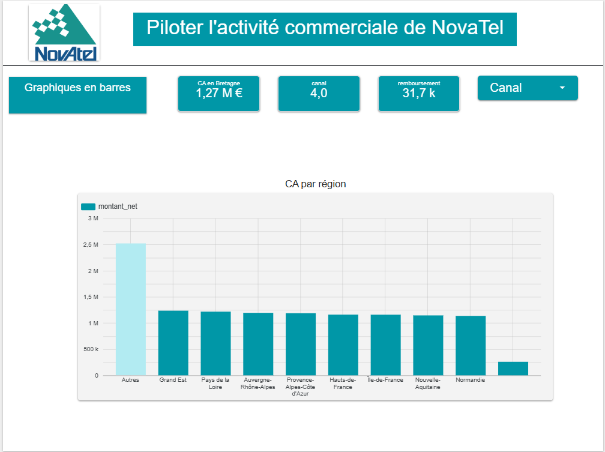
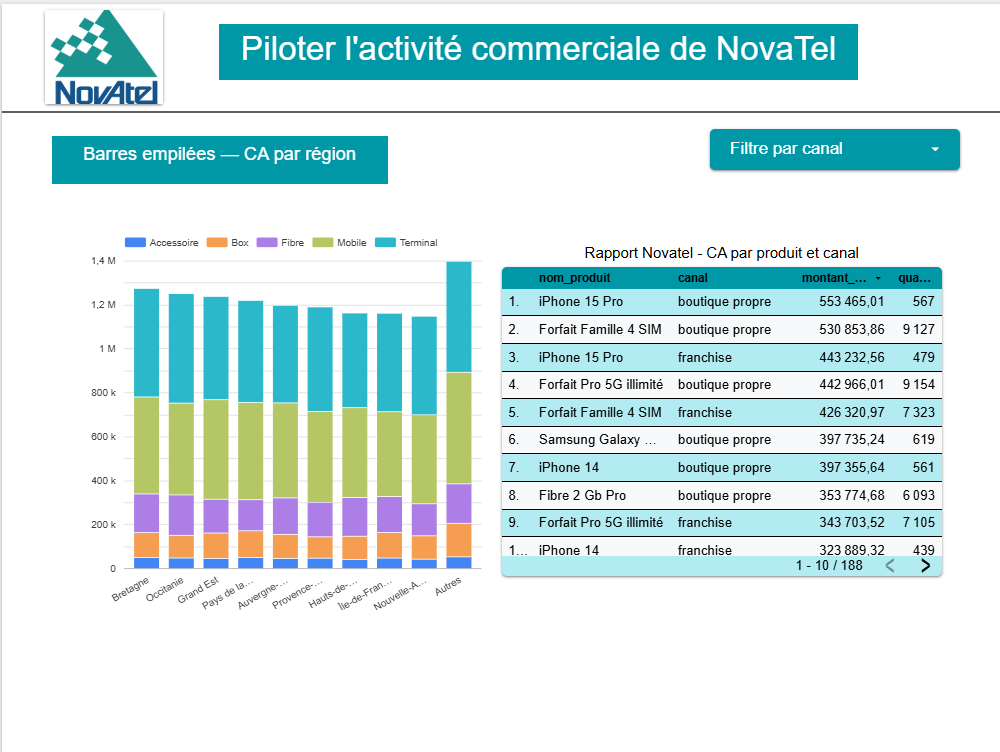
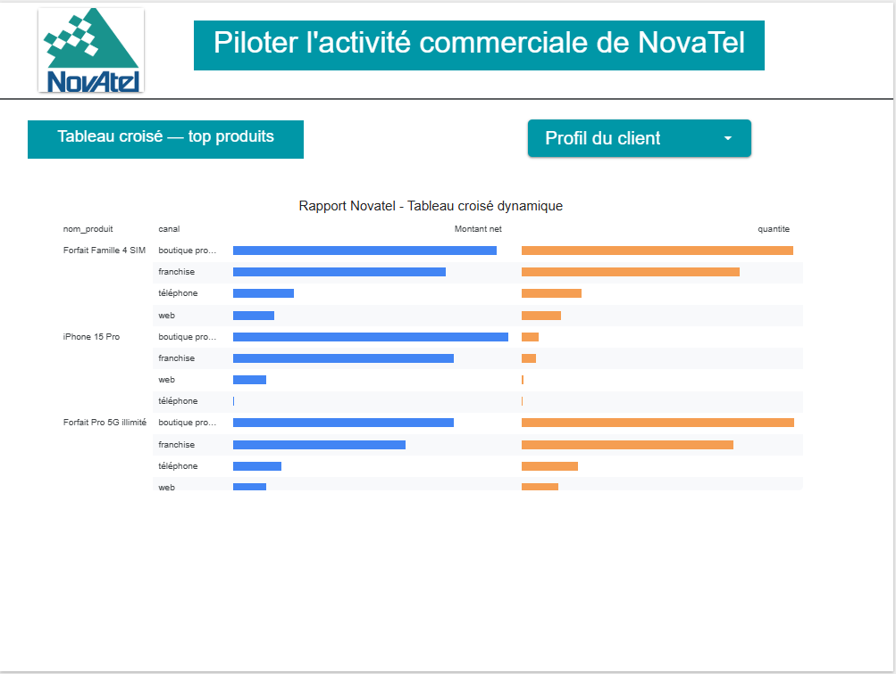
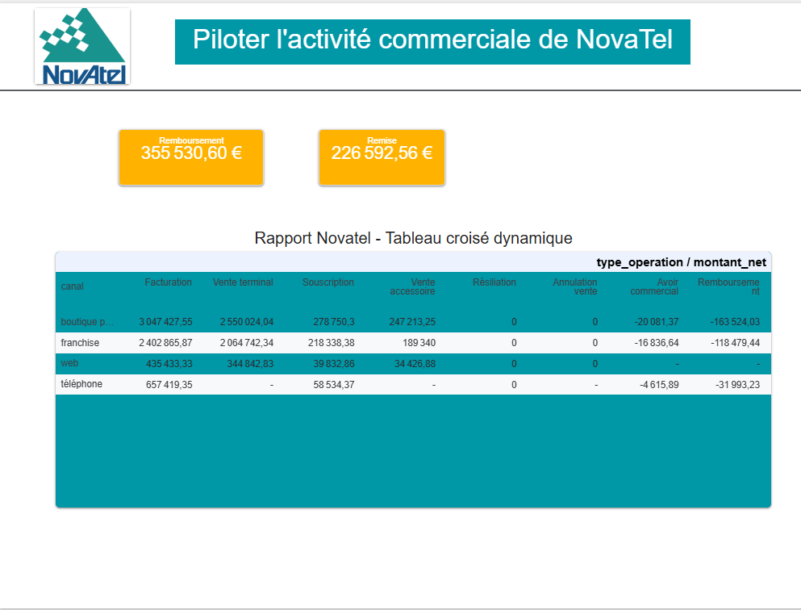
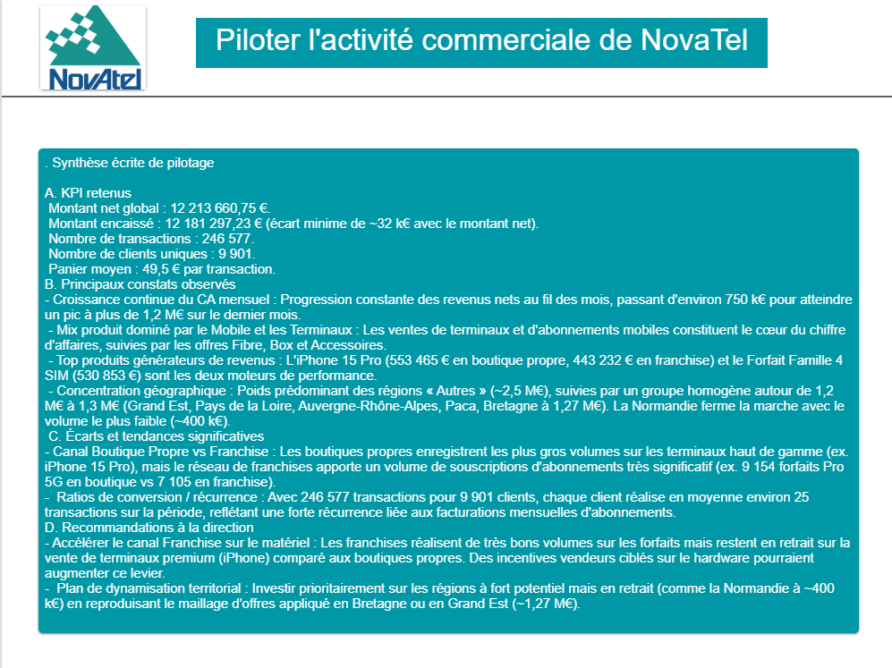

# 📊 Analyse et Tableau de bord - Performance Commerciale NovaTel

Ce projet présente l'analyse complète de l'activité commerciale et des transactions de la société **NovaTel**, de la structuration et l'extraction des données via Google BigQuery jusqu'à la création d'un tableau de bord interactif sur Looker Studio.

## 🛠️ Stack Technique
- **Base de données / Entrepôt :** Google BigQuery
- **Connecteur de données :** BigQuery Connector
- **Visualisation & Business Intelligence :** Looker Studio

## 📂 Contenu du dossier
- `Novatel_requetes.sql` : Les requêtes et vues SQL rédigées en Standard SQL sous BigQuery (`vw_transactions_reporting`).
- `Novatel1.png` à `Novatel6.png` : Captures d'écran et aperçus visuels du tableau de bord.

## 🔗 Lien vers le rapport en direct
[Clique ici pour consulter le dashboard interactif NovaTel sur Looker Studio](https://datastudio.google.com/reporting/41764716-dd58-4323-baaf-bd7456e25822/page/FyqAG)

## 📊 Aperçu du Tableau de Bord

